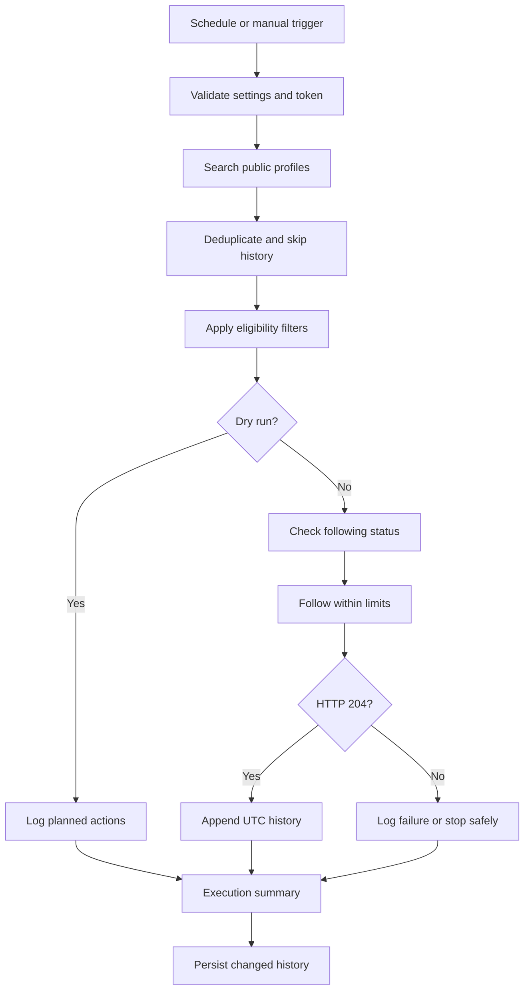

# GitHub Profile Automation

> Python + GitHub Actions automation to discover public GitHub profiles, apply eligibility rules, follow a small capped number of accounts, and log confirmed follows.
>
> **Responsible use:** Keep limits conservative and comply with GitHub's current Terms of Service and Acceptable Use Policies. Automated bulk engagement may cause rate limits or account restrictions.

## Project overview

| Item | Details |
|---|---|
| Language | Python 3.12+ |
| Automation | GitHub Actions |
| API | GitHub REST API |
| Runtime dependency | `requests` |
| Test framework | `pytest` |
| Default follow limit | `5` attempts per run |
| Hard limit | `50` attempts per run |
| Default minimum account age | `30` days |
| History file | `data/users_follows.txt` |
| Triggers | Scheduled and manual |
| Dry run | Supported; no follow action or history write |

## Features

| Feature | What it does |
|---|---|
| Profile discovery | Searches public GitHub profiles using the official user-search API. |
| Eligibility | Filters by account type, account age, and excluded usernames. |
| Duplicate prevention | Deduplicates account IDs; skips your own profile and usernames already in history. |
| Follow limits | Enforces a configurable per-run cap, a hard ceiling, request delays, and a runtime budget. |
| Dry run | Logs planned actions without following accounts or writing history. |
| API resilience | Uses timeouts, bounded retries, backoff, and rate-limit-aware stopping. |
| Audit history | Records confirmed follows with UTC timestamps. |
| CI automation | Supports scheduled/manual runs and concurrency protection. |
| Tests | Mocks GitHub API calls so tests do not follow real accounts. |

## How it works

| Step | Action |
|---:|---|
| 1 | GitHub Actions starts on schedule or manual trigger. |
| 2 | The app validates settings and authenticates with `GH_TOKEN`. |
| 3 | Discovery searches GitHub, deduplicates results, and skips self/history entries. |
| 4 | Eligibility rules accept or reject candidates with a reason. |
| 5 | The follow service checks following status and applies limits/delays. |
| 6 | A follow is logged only after GitHub returns `204 No Content`. |
| 7 | The workflow attempts to commit changed history to the configured branch. |



## Repository layout

| Path | Responsibility |
|---|---|
| `.github/workflows/auto-follow.yml` | Triggers, inputs, permissions, concurrency, and history persistence. |
| `src/config.py` | Loads and validates configuration; protects token values. |
| `src/github_client.py` | API requests, timeouts, retries, backoff, and rate-limit handling. |
| `src/discovery.py` | Searches pages, deduplicates account IDs, and skips self/history. |
| `src/eligibility.py` | Applies account type, age, and exclusion rules. |
| `src/follow_service.py` | Runs the follow pipeline and enforces limits. |
| `src/history.py` | Reads and appends UTC history records. |
| `src/main.py` | Orchestrates modules, logs summaries, and returns exit codes. |
| `tests/` | Unit tests using mocked API calls. |
| `data/users_follows.txt` | Append-only follow history. |
| `requirements.txt` | Runtime dependencies. |
| `requirements-dev.txt` | Runtime and test dependencies. |
| `pytest.ini` | Pytest configuration. |
| `.gitignore`, `.gitattributes` | Git exclusions and history merge behavior. |

## Requirements

| Requirement | Details |
|---|---|
| GitHub account | The account that will perform follows. |
| Repository | GitHub repository with Actions enabled. |
| Python | 3.12+ for local runs/tests. |
| Secret | `GH_TOKEN` containing a PAT with follow permission. |
| Workflow permission | `contents: write` for the history-update job. |

## Setup

### 1. Push the project

Ensure `src/` and `.github/workflows/auto-follow.yml` are at the repository root.

```bash
git init -b main
git add .
git commit -m "Initial commit"
git remote add origin git@github.com:adidongre006/github-auto-follow.git
git push -u origin main
```

### 2. Create a personal access token

Create the token while signed in to the account that should follow profiles.

| Token type | Required permission |
|---|---|
| Fine-grained (preferred) | Account permissions → **Followers: Read and write**. Repository access is not needed for following. |
| Classic | Only the `user:follow` scope. |

Set an expiration date and store the token securely. Never commit it, paste it into issues/chat, or print it in logs.

### 3. Add the secret

Go to **Repository → Settings → Secrets and variables → Actions → Secrets → New repository secret**.

| Name | Value |
|---|---|
| `GH_TOKEN` | Your personal access token (PAT) |

### 4. Allow history commits

In **Settings → Actions → General → Workflow permissions**, allow the workflow to use `contents: write` where required. Respect branch protection and review rules.

### 5. Test safely

1. Open **Actions → Auto Follow → Run workflow**.
2. Enable **Dry run** and set a small limit, such as `5`.
3. Inspect logs and candidate selection.
4. Disable dry run only after confirming the behavior is expected.

## Authentication and API permissions

| Credential | Purpose | Important note |
|---|---|---|
| `GH_TOKEN` | Authenticates as your user for follow actions. | PAT with follow permission; store as a repository secret. |
| `GITHUB_TOKEN` | Allows the workflow to update repository contents. | Automatically generated and repository-scoped; it cannot perform user follows. |

| Operation | REST endpoint | Requirement |
|---|---|---|
| Identify authenticated user | `GET /user` | Valid token |
| Search users | `GET /search/users` | Valid token |
| Get profile details | `GET /users/{username}` | Public profile access |
| Check following status | `GET /user/following/{username}` | Valid token |
| Follow a user | `PUT /user/following/{username}` | Fine-grained **Followers: write** or classic `user:follow` |

## Configuration reference

Set non-secret values in **Settings → Secrets and variables → Actions → Variables**. Keep `GH_TOKEN` under **Secrets**. Unset variables use their defaults.

| Setting | Default | Purpose / accepted values |
|---|---:|---|
| `GH_TOKEN` | Required secret | PAT with follow permission. |
| `MAX_FOLLOWS` | `5` | Follow attempts per run; range `1–50`. |
| `SEARCH_QUERY` | `type:user repos:>=1` | GitHub user-search query. |
| `SEARCH_LANGUAGE` | Unset | Optional language filter, appended as `language:<value>`. |
| `SEARCH_SORT` | `joined` | `joined`, `followers`, `repositories`, or `best-match`. |
| `SEARCH_ORDER` | `desc` | Search order, e.g. `asc` or `desc` where supported. |
| `MAX_SEARCH_PAGES` | `3` | Search pages; range `1–10`, up to 100 results per page. |
| `ACCOUNT_TYPES` | `user` | Comma-separated allowed types: `user`, `organization`, `bot`. |
| `MIN_ACCOUNT_AGE_DAYS` | `30` | Minimum account age in days; `0` disables this filter. |
| `EXCLUDED_USERS` | Unset | Comma- or space-separated usernames to skip. |
| `DRY_RUN` | `false` | `true` logs proposed actions without following or writing history. |
| `HISTORY_FILE` | `data/users_follows.txt` | Append-only history file path. |
| `HISTORY_BRANCH` | Workflow default branch | Optional branch for history persistence. |
| `FOLLOW_DELAY` | `2` | Seconds between follow requests. |
| `REQUEST_TIMEOUT` | `15` | HTTP request timeout in seconds. |
| `MAX_RETRIES` | `3` | Bounded retry count for transient errors. |
| `MAX_RATE_LIMIT_WAIT` | `60` | Maximum accepted rate-limit wait; longer waits stop the run safely. |
| `MAX_RUNTIME_SECONDS` | `600` | Application runtime budget. |
| `MAX_CONSECUTIVE_FAILURES` | `5` | Stop after this many consecutive failures. |

**Limit precedence:** A manual workflow input takes priority over the `MAX_FOLLOWS` variable, which takes priority over the default `5`. The app enforces the hard ceiling of `50`.

## Run and schedule

| Method | How to run |
|---|---|
| Scheduled | The `cron` value in `.github/workflows/auto-follow.yml` is the source of truth. Cron schedules use UTC and may be delayed by GitHub Actions. |
| Manual | Open **Actions → Auto Follow → Run workflow** and set available inputs such as `max_follows` or `dry_run`. |
| Local dry run | Set `GH_TOKEN` securely and run `DRY_RUN=true python -m src.main`. |

Example cron schedules (UTC):

| Cron | Meaning |
|---|---|
| `17 */6 * * *` | Every 6 hours, at minute 17. |
| `17 * * * *` | Every hour, at minute 17. |
| `17 9 * * *` | Daily at 09:17. |
| `17 9 * * 1` | Every Monday at 09:17. |

> **Schedule note:** The walkthrough and technical reference have described different intervals. Check the actual workflow YAML before relying on a particular cadence.

### Protected default branch

| Situation | Recommended action |
|---|---|
| Default branch blocks direct pushes | Configure `HISTORY_BRANCH` to a permitted automation branch. |
| History update fails | Verify checkout/push logic and `contents: write` permission. |
| Organization requires approvals | Follow the normal environment and branch-protection rules; do not bypass them. |

## History and persistence

Example `data/users_follows.txt` line:

```text
2026-10-10T16:30:00Z | username | https://github.com/username
```

| Rule | Behavior |
|---|---|
| Timestamp | ISO 8601 UTC, ending in `Z`. |
| When recorded | Only after GitHub confirms the follow with `204 No Content`. |
| File behavior | Append-only; history is re-read before appending. |
| Parsing | Blank lines and `#` comments are ignored; malformed lines are logged and skipped. |
| Persistence | Workflow attempts to commit changed history and may retry a rebase/push. |
| Concurrent runs | A concurrency group prevents overlapping runs in the same group. |
| Not recorded | Already-followed profiles and profiles rejected by eligibility rules. These may be reconsidered later. |

## Execution summary and exit codes

| Metric | Meaning |
|---|---|
| Raw profiles discovered | Search results received, including duplicates. |
| Unique profiles found | Results after deduplication. |
| Unique profiles considered | New candidates after skipping self and history entries. |
| Skipped: own account | Authenticated account was ignored. |
| Skipped: history | Username already appears in history. |
| Rejected by eligibility | Candidate failed one or more rules. |
| Followed successfully | GitHub confirmed the follow and a history record was written. |
| Already followed | No new follow request was needed. |
| Failed attempts | Follow or profile-processing errors. |
| Rate-limit interruption | Application stopped or deferred work due to rate limits. |
| Interrupted | Run was cancelled or reached its time budget. |

| Exit code | Meaning |
|---:|---|
| `0` | Completed, including safe rate-limit or time-budget stops. |
| `1` | Runtime failure, such as authentication or history persistence failure. |
| `2` | Invalid configuration. |
| `130` | Cancelled by an interrupt signal. |

## Safety and security

| Risk | Mitigation |
|---|---|
| Excessive activity | Default of 5 attempts, hard ceiling of 50, request delay, page limit, and runtime budget. |
| Duplicate profiles | Deduplication by account ID and history checks. |
| API rate limits | Bounded retries, server wait hints, and safe stopping. |
| Temporary network errors | Exponential backoff capped at 30 seconds. |
| Invalid token | Clear failure; repeated consecutive failures trigger an abort. |
| Uncertain response | Only `204 No Content` counts as a confirmed follow. |
| Token exposure | Secret environment variable; token excluded from representations/logs. |
| Excessive permissions | PAT only needs follow permission; repository write is scoped to history updates. |
| Overlapping runs | GitHub Actions concurrency group. |

- Prefer an expiring fine-grained PAT and rotate it regularly.
- Never attempt to bypass rate limits with extra tokens or accounts.
- This project follows accounts only; it does **not** unfollow or reconcile accounts.
- Respect repository branch protection, required reviews, and environment approvals.

## Troubleshooting

| Symptom | Likely cause | Fix |
|---|---|---|
| `GH_TOKEN is not set` | Missing or misspelled secret | Add the repository secret named exactly `GH_TOKEN`. |
| Token begins `ghs_...` | Workflow token used instead of a user PAT | Create a PAT with follow permission. |
| `401 Unauthorized` | Expired, revoked, or incorrect token | Replace the PAT and update the secret. |
| `403 Forbidden` or repeated follow `404` | Permission or authorization issue | Verify **Followers: Read and write** or `user:follow`. |
| History push fails | Branch protection or missing write permission | Configure `HISTORY_BRANCH` and verify workflow permissions. |
| Rate-limit warning / early stop | GitHub asked the client to slow down | Let a later run continue; do not bypass the limit. |
| No candidates found | Search exhausted or candidates filtered/processed | Review search, language, exclusions, and account-age settings. |
| Schedule stops running | Scheduled workflows may be disabled on inactive public repositories | Check the Actions tab and re-enable if needed. |
| Configuration validation error | Invalid variable value or format | Correct or remove the variable, then rerun. |

### Stop the automation

| Goal | Action |
|---|---|
| Pause future runs | Disable the workflow in **Actions → Auto Follow**. |
| Cancel current run | Open the active run and choose **Cancel workflow**. |
| Revoke automation access | Remove `GH_TOKEN` from repository secrets and revoke the PAT in GitHub settings. |

## Local development and tests

```bash
python -m venv .venv
source .venv/bin/activate          # Windows: .venv\Scripts\activate
pip install -r requirements-dev.txt
pytest
```

Local read-only discovery / dry run:

```bash
export GH_TOKEN="<your-personal-access-token>"
DRY_RUN=true python -m src.main
```

| Practice | Reason |
|---|---|
| Run tests before changes | API calls are mocked; tests should not follow real accounts. |
| Keep tokens out of shell history | Use your operating system's secure environment-variable method. |
| Review local history before committing | Local runs use the configured history path. |

## Limitations

| Limitation | Impact |
|---|---|
| GitHub search cap | User search exposes at most the first 1,000 results for a query. |
| Missing account creation date | Account-age filter may not be usable for every profile. |
| Rejected/previously-followed accounts | Not stored as confirmed follows and may be checked again later. |
| Changing API behavior | Verify endpoints and token permissions against the current [GitHub REST API documentation](https://docs.github.com/en/rest). |
| Scheduled-run variability | Timing depends on cron, repository activity, Actions availability, and scheduling delays. |
| Candidate suitability | Search/eligibility rules do not guarantee every profile is relevant. |

## Glossary

| Term | Plain-English meaning |
|---|---|
| GitHub Actions | GitHub service for running workflows on events or schedules. |
| Workflow | YAML instructions defining triggers, jobs, and permissions. |
| Cron | Expression specifying a scheduled run time. |
| Secret | Protected value, such as a token, stored by GitHub. |
| PAT | Personal access token that authenticates as your GitHub user. |
| REST API | Official interface for software to interact with GitHub. |
| Rate limit | Restriction on request/action frequency. |
| Pagination | Splitting a large result set into pages. |
| Idempotent | Designed to avoid duplicate effects when repeated. |
| Backoff | Waiting progressively longer between retry attempts. |
| Dry run | Rehearsal that logs planned actions without performing follows. |
| Concurrency group | Rule that prevents overlapping workflow runs in the same group. |
| ISO 8601 UTC | Standard timestamp format, e.g. `2026-10-10T16:30:00Z`. |

---
